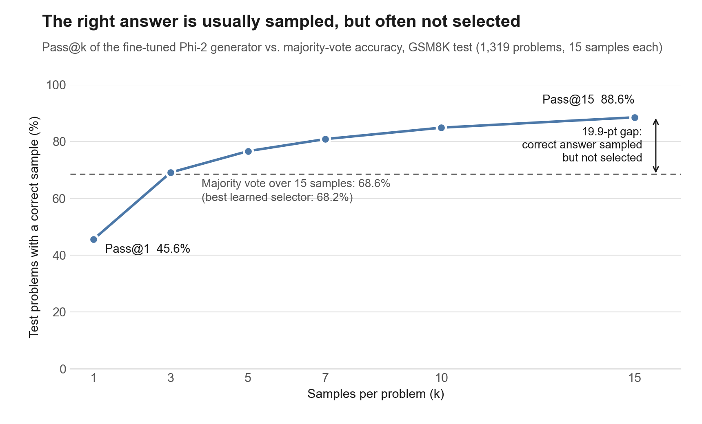
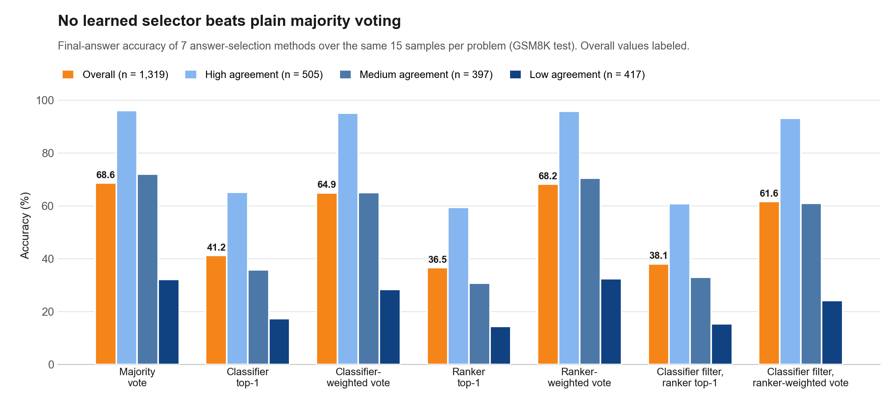
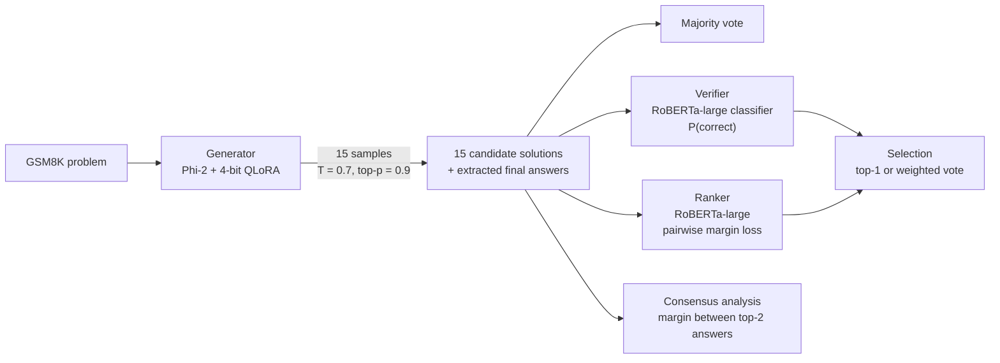
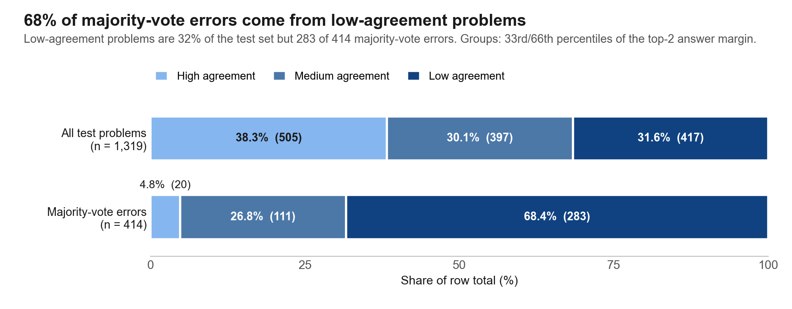

# SMOLSolver: Generate-then-Rank Math Reasoning with Small LMs

Sample 15 solutions per problem from a QLoRA-fine-tuned Phi-2, then choose one answer: majority voting vs. a learned RoBERTa verifier and ranker, evaluated on GSM8K.

When a small language model samples many solutions to a math problem, can a small learned verifier pick the right answer better than simple majority voting? SMOLSolver fine-tunes Phi-2 with 4-bit QLoRA on GSM8K, samples 15 solutions for each of the 1,319 test problems, and compares 7 answer-selection methods built from majority voting, a RoBERTa-large correctness classifier and a RoBERTa-large pairwise ranker. A correct answer is among the 15 samples for **88.55%** of problems, but majority voting selects it for only **68.61%**, and no learned selector beat majority voting (best: ranker-weighted voting, 68.16%). Most majority-vote errors (283 of 414, **68%**) come from the low-agreement third of the test set, where the samples disagree most.



## Key results

Final-answer accuracy (%) on the GSM8K test set, 15 samples per problem. Best selection method per column in bold.

| Method | Overall (n = 1,319) | High agreement (n = 505) | Medium agreement (n = 397) | Low agreement (n = 417) |
|---|---|---|---|---|
| (i) Majority vote | **68.61** | **96.04** | **72.04** | 32.13 |
| (ii) Classifier top-1 | 41.17 | 65.15 | 35.77 | 17.27 |
| (iii) Classifier-weighted vote | 64.90 | 95.05 | 64.99 | 28.30 |
| (iv) Ranker top-1 | 36.54 | 59.41 | 30.73 | 14.39 |
| (v) Ranker-weighted vote | 68.16 | 95.84 | 70.53 | **32.37** |
| (vi) Classifier filter, ranker top-1 | 38.06 | 60.79 | 33.00 | 15.35 |
| (vii) Classifier filter, ranker-weighted vote | 61.64 | 93.07 | 60.96 | 24.22 |
| *Reference: first sample only (Pass@1)* | *45.56* | *77.82* | *37.28* | *14.39* |
| *Reference: any of 15 samples correct (Pass@15, oracle)* | *88.55* | *98.22* | *90.43* | *75.06* |

<sub>Source: rows (i)–(vii) from [`results/ranker_eval_results.json`](results/ranker_eval_results.json) (written by `src/evaluation/evaluate_selectors.py`); reference rows from [`results/test_sample_stats.json`](results/test_sample_stats.json) (recomputed from `results/group_*.json` by `src/analysis/summarize_test_samples.py`).</sub>



## Method



| Component | What it is | Script |
|---|---|---|
| Generator | `microsoft/phi-2`, 4-bit NF4 quantization + LoRA (r = 16, α = 16, dropout 0.1) on the attention projections; 2 epochs on 90% of the GSM8K train split, lr 1e-4, effective batch 32 | `src/generator/train_generator.py` |
| Test-time sampling | 15 samples per test problem (temperature 0.7, top-p 0.9, ≤ 256 new tokens); final answer extracted by regex and compared with the ground truth | `src/generator/sample_test_solutions.py` |
| Selector training data | 7 sampled solutions for each of 2,000 GSM8K train-split questions (plus 500 held-out questions), labeled correct / incorrect by final-answer match | `src/verifier/generate_verifier_data.py` |
| Verifier (classifier) | `roberta-large`, full fine-tune, 2-class cross-entropy on `Question [SEP] Solution`; class-balanced, 5 samples per question, early stopping on validation AUC | `src/verifier/train_verifier.py` |
| Ranker | `roberta-large` + mean pooling + MLP head giving one score per solution; `MarginRankingLoss` (margin 0.5) on all (correct, incorrect) pairs from the same question | `src/ranker/train_ranker.py` |

**Selection methods** (all choose among the same 15 samples):

- **Majority vote**: most frequent extracted answer.
- **Top-1** (classifier, ranker): answer of the single highest-scoring solution.
- **Weighted vote**: each answer gets the sum of its solutions' scores (classifier: probabilities of solutions above 0.5; ranker: scores shifted to be positive).
- **Classifier filter, then ranker**: keep solutions with classifier probability > 0.5, then ranker top-1 or ranker-weighted vote.

## Consensus analysis

For each problem, let *r1* and *r2* be the fractions of the 15 samples that give the most common and second most common answer. The **margin** *r1 − r2* measures how strongly the samples agree. Problems are split at the 33rd and 66th percentiles of the margin (τ_low ≈ 0.133 = 2/15, τ_high ≈ 0.533 = 8/15): low agreement means the top answer leads by about 0–2 votes out of 15, high agreement by about 8 or more. The grouping uses only the model's own answers, no labels.

| Group | Problems | Pass@15 | Majority vote | Majority-vote errors | Share of all errors |
|---|---|---|---|---|---|
| High agreement | 505 | 98.22% | 96.04% | 20 | 4.83% |
| Medium agreement | 397 | 90.43% | 72.04% | 111 | 26.81% |
| Low agreement | 417 | 75.06% | 32.13% | 283 | **68.36%** |
| All | 1,319 | 88.55% | 68.61% | 414 | 100% |

<sub>Source: [`results/test_sample_stats.json`](results/test_sample_stats.json); thresholds and group sizes in [`results/classify_metadata.json`](results/classify_metadata.json).</sub>



## What worked, what did not

**Worked**

- **Sampling + majority voting.** Going from one sample to a vote over 15 raises accuracy from 45.56% to 68.61% (+23.05 points) with no extra model.
- **Agreement as a free confidence signal.** Majority vote is 96.04% accurate when the samples agree strongly and 32.13% when they do not, so the margin flags which answers to trust.

**Did not work**

- **Learned selectors did not beat majority voting.** The best, ranker-weighted voting, scored 68.16% overall: 6 problems behind majority vote (899 vs. 905 of 1,319). It was lower on the high (95.84% vs. 96.04%) and medium (70.53% vs. 72.04%) groups and higher only on the low group, by a single problem (32.37% vs. 32.13%, 135 vs. 134 of 417).
- **Picking one solution by score was worse than taking the first sample.** Classifier top-1 (41.17%) and ranker top-1 (36.54%) are below simply taking the first sample (45.56%).
- **Stacking the classifier and ranker did not help.** Classifier filter + ranker top-1 reached 38.06% (below classifier top-1, above ranker top-1); the weighted version reached 61.64%, below both single-model weighted votes.

**Where the headroom is.** Errors concentrate in low-agreement problems: they are 32% of the test set but 68% of majority-vote errors, and a correct answer is still among the samples for 75.06% of them. A selector only pays off if it can win there, which none of the learned selectors did.

**Possible reasons (not tested in this project).** The selectors were trained on only 2,000 questions with outcome-level labels; their training solutions were generated with a different prompt and a 96-token limit, while test candidates use another prompt and up to 256 tokens; and most of their training questions were also in the generator's fine-tuning data, so their errors may look different from test-time errors.

## Repository structure

```
.
├── src/
│   ├── generator/
│   │   ├── train_generator.py         # Phi-2 + QLoRA fine-tuning on GSM8K
│   │   ├── eval_generator.py          # greedy Pass@1 on the validation split (optional)
│   │   └── sample_test_solutions.py   # 15 samples per test problem -> test_k15.json
│   ├── verifier/
│   │   ├── generate_verifier_data.py  # labeled samples for verifier/ranker training
│   │   └── train_verifier.py          # RoBERTa-large binary classifier
│   ├── ranker/
│   │   └── train_ranker.py            # RoBERTa-large pairwise margin ranker
│   ├── evaluation/
│   │   ├── evaluate_selectors.py      # the 7 selection methods -> results/ranker_eval_results.json
│   │   └── evaluate_classifier_only.py  # earlier classifier-only evaluation (superseded)
│   └── analysis/
│       ├── classify_by_margin.py      # consensus groups -> results/group_*.json
│       ├── summarize_test_samples.py  # Pass@k and majority-vote stats from the group files
│       └── make_figures.py            # figures/*.png
├── results/
│   ├── ranker_eval_results.json       # accuracy of the 7 methods, overall and per group
│   ├── classify_metadata.json         # thresholds, margin statistics, group sizes
│   ├── group_{high,medium,low}.json   # the 1,319 test problems with all 15 samples (6–8 MB each)
│   ├── test_sample_stats.json         # Pass@k (k = 1..15) and majority-vote errors per group
│   └── pass_at_k.json                 # Pass@k table from the original README (incl. train/eval splits)
├── figures/                           # PNGs used in this README
└── requirements.txt
```

## Reproducing

All scripts are run from the repository root. Training and sampling need an NVIDIA GPU (4-bit bitsandbytes, fp16); `requirements.txt` is the pinned Linux/CUDA 12 environment used for the project. Model checkpoints and generated training data are written to the repository root and are not included (see `.gitignore`).

```bash
pip install -r requirements.txt

# 1. Generator
python src/generator/train_generator.py          # -> generator_ovm/
python src/generator/eval_generator.py           # optional: greedy Pass@1 on the validation split

# 2. Verifier and ranker
python src/verifier/generate_verifier_data.py    # -> verifier_data/
python src/verifier/train_verifier.py            # -> verifier_RoBERTa/
python src/ranker/train_ranker.py                # -> ranker_roberta/

# 3. Test-time samples and consensus groups
python src/generator/sample_test_solutions.py    # -> test_k15.json
python src/analysis/classify_by_margin.py        # -> results/group_*.json, results/classify_metadata.json

# 4. Evaluate the 7 selection methods (needs the checkpoints from step 2)
python src/evaluation/evaluate_selectors.py      # -> results/ranker_eval_results.json

# 5. Statistics and figures (CPU only, uses the files in results/)
python src/analysis/summarize_test_samples.py    # -> results/test_sample_stats.json
python src/analysis/make_figures.py              # -> figures/*.png
```

`test_k15.json` itself is not in the repository, but the same 15 samples per problem are stored in `results/group_*.json`, so step 5 runs without a GPU or any checkpoints. The `config` paths recorded inside `results/ranker_eval_results.json` refer to the original flat layout (e.g. `./group_high.json`, now `results/group_high.json`).

Generator-only Pass@k (%) for the other data splits, from the original project README:

| k | GSM8K train subset (2,000 Q) | Held-out train subset (500 Q) | GSM8K test (1,319 Q) |
|---|---|---|---|
| 1 | 46.85 | 51.60 | 45.56 |
| 3 | 67.50 | 69.20 | 69.14 |
| 5 | 73.70 | 76.20 | 76.65 |
| 7 | 77.45 | 79.60 | 80.89 |
| 10 | – | – | 84.91 |
| 15 | – | – | 88.55 |

<sub>Source: train and held-out columns copied from the original README into [`results/pass_at_k.json`](results/pass_at_k.json); they come from verifier-data generation (7 samples, ≤ 96 new tokens), whose outputs are not included. Test column from [`results/test_sample_stats.json`](results/test_sample_stats.json); k = 1, 10, 15 match the original README.</sub>

## Limitations

- **One run, one seed.** No confidence intervals or significance tests; differences of a few problems (e.g. 905 vs. 899 of 1,319) should not be over-read.
- **Answer extraction.** Correctness is a regex-extracted final number compared with the ground truth; extraction failures count as wrong.
- **Train/test mismatch.** The generator was fine-tuned with a different prompt template than the one used for test-time sampling, and the selectors were trained on samples with different prompts and length limits than the test candidates (see above).
- **Threshold ties.** Both thresholds equal attainable margins (2/15 and 8/15). Because the comparison is done in floating point, problems whose top answer leads by exactly 2 votes landed in both the low (82) and medium (30) groups, and those leading by exactly 8 in both the medium (12) and high (69) groups. The groups are therefore approximate; the reported group results use the groups as stored in `results/`.
- **Thresholds from the test set.** The percentile thresholds are computed on the test problems (without labels), so the groups describe this test set rather than a tuned, deployable router.
- **Not included.** Model checkpoints, the verifier/ranker training data and the validation metrics of the verifier and ranker are not part of this repository.

---

NYU course project, Fall 2025. Data: [GSM8K](https://github.com/openai/grade-school-math) (Cobbe et al., 2021).
